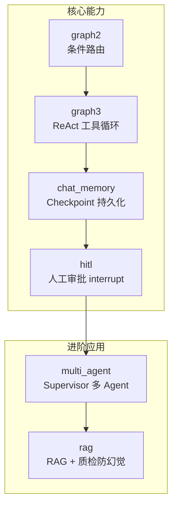

# LangGraph 企业级 Agent 实战

基于 LangGraph 构建的多模式 Agent 系统演示，覆盖生产级 Agent 的 6 大核心机制：条件路由、ReAct 工具循环、Checkpoint 持久化、Human-in-the-loop 审批、多 Agent 编排、RAG 检索增强（含防幻觉）。

## 架构总览



## 功能演示

### 1. ReAct 工具循环
LLM 自主决策调用工具（计算器/天气查询），工具结果回填后继续推理，循环至给出最终答案。

### 2. Checkpoint 断点恢复
对话状态持久化到 SQLite，程序重启后同 `thread_id` 会话记忆不丢失（durable execution）。

### 3. Human-in-the-loop 人工审批
Agent 生成内容后，图在 `interrupt()` 处暂停，人工批准后通过 `Command(resume=...)` 恢复执行；拒绝则走终止分支。适用于所有敏感操作门控。

### 4. 多 Agent Supervisor 编排
researcher（调研）→ analyst（分析）→ writer（成文），由 Supervisor 节点基于当前状态动态路由。

### 5. RAG 检索增强 + 防幻觉
Qdrant 向量检索 → LLM 质检检索相关性 → 不相关则改写查询重试 → 生成时强制"仅依据资料"。知识库外的问题回答"未提及"而非编造。

## 快速开始

```bash
# 1. 环境（Python 3.10+）
python -m venv venv
venv\Scripts\activate        # Windows
pip install -r requirements.txt

# 2. 配置模型 Key（DeepSeek，兼容 OpenAI 接口）
setx OPENAI_API_KEY "sk-xxx"

# 3. 逐个运行（建议按编号顺序）
python graph1.py      # 最小 StateGraph
python graph2.py      # 条件路由
python graph3.py      # ReAct 工具循环
python chat_memory.py # Checkpoint 记忆（改 FIRST_RUN=False 验证断点恢复）
python hitl.py        # 人工审批
python multi_agent.py # 多 Agent 编排
python rag.py         # RAG（首次运行需下载 embedding 模型）
```

> 国内下载 HuggingFace 模型需设镜像：`$env:HF_ENDPOINT = "https://hf-mirror.com"`

## 项目结构

```
langgraph-demo/
├── test_llm.py        # 模型连通测试
├── graph1.py          # 最小图：State + Node + Edge
├── graph2.py          # 条件路由（分类器 → 专家分派）
├── graph3.py          # ReAct：agent ⇄ tool 循环
├── chat_memory.py     # SQLite Checkpoint + 断点恢复
├── hitl.py            # interrupt + Command(resume) 人工审批
├── multi_agent.py     # Supervisor 多 Agent 架构
├── rag.py             # RAG：检索 → 质检 → 改写重试 → 生成
└── requirements.txt
```

## 技术要点与踩坑记录

| 问题 | 原因 | 解法 |
|---|---|---|
| 条件边报 unknown target | 路由返回值未映射到节点 | `add_conditional_edges` 第三参传 route_map，`FINISH → END` |
| 中文文档检索漏检 | 误用英文向量模型 bge-small-en | 换 `BAAI/bge-small-zh-v1.5` |
| 向量维度报错 | zh 模型输出 512 维，en 版 384 维 | 建库 `VectorParams(size=512)` 与模型对齐 |
| HuggingFace 下载超时 | 国内网络 | `$env:HF_ENDPOINT="https://hf-mirror.com"` |
| 多轮对话记忆丢失 | 状态只在内存 | `SqliteSaver` 按 thread_id 落盘 |

## 技术栈

LangGraph 1.0 · LangChain · DeepSeek (OpenAI 兼容接口) · Qdrant (内存模式) · fastembed (bge-small-zh) · SQLite Checkpoint
